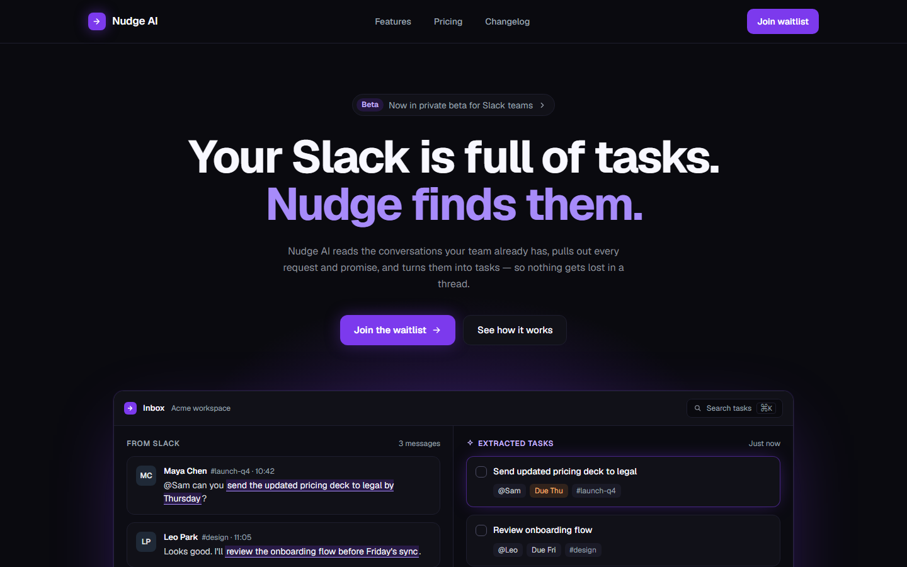

# Nudge AI — landing page

A fictional SaaS that turns Slack conversations into tasks. Portfolio project, not a real product.

**Live:** https://nudge-ai-lac.vercel.app



## Results

PageSpeed Insights, production (2026-11-12):
- Mobile: Performance 100, Accessibility 100, Best Practices 100, SEO 100
- Desktop: Performance 100, Accessibility 100, Best Practices 100, SEO 100

## Design

My own design, created in Claude Design (claude.ai), inspired by modern AI/SaaS landing pages. Implemented from the saved HTML design (`design/reference.html`, not in the repo). Customer logos, prices and product copy are samples, not real claims.

## What's inside

- Responsive from 360 to 2560 px
- Waitlist form: React Hook Form + Zod (one schema for client and server), Route Handler + Resend, honeypot field, request size limit, 400/413/502/503 responses, accessible errors and status
- First screen without animation (fast LCP); CSS reveal-on-scroll with one IntersectionObserver; respects `prefers-reduced-motion`; no animation library
- Accessibility: semantic sections, keyboard-friendly mobile menu (`aria-expanded`, Escape), 44 px tap targets, WCAG AA contrast
- SEO: Metadata API, Open Graph image, icons, sitemap, robots, JSON-LD
- Security headers (CSP `frame-ancestors`, `nosniff`, Referrer-Policy, Permissions-Policy, COOP), no `X-Powered-By`

## Stack

Next.js 16 (App Router), React 19, TypeScript, Tailwind CSS v4, Zod 4, React Hook Form, Resend, Vercel, pnpm.

## Run locally

```bash
pnpm install
cp .env.example .env.local   # then fill RESEND_API_KEY and NOTIFICATION_EMAIL
pnpm dev
```

Without the env vars the waitlist form answers 503 by design. The site runs at http://localhost:3000.

| Script | What it does |
|---|---|
| `pnpm dev` | Dev server on port 3000 |
| `pnpm build` | Production build |
| `pnpm prod` | Build + production server on port 3001 |
| `pnpm lint` | ESLint |
| `pnpm typecheck` | TypeScript check, no emit |
| `pnpm qa:visual` | Screenshots + layout checks (dev server must run) |
| `pnpm qa:lh` | Lighthouse summary, 3 runs, against `pnpm prod` |

## Deploy

Vercel. Add `RESEND_API_KEY` and `NOTIFICATION_EMAIL` as Sensitive environment variables for Production and Preview. Node 26.x (`engines` in `package.json`).

## Credits

Fonts: Geist (SIL Open Font License), loaded via `next/font`.

Design and development: Oleksandr Martian.
